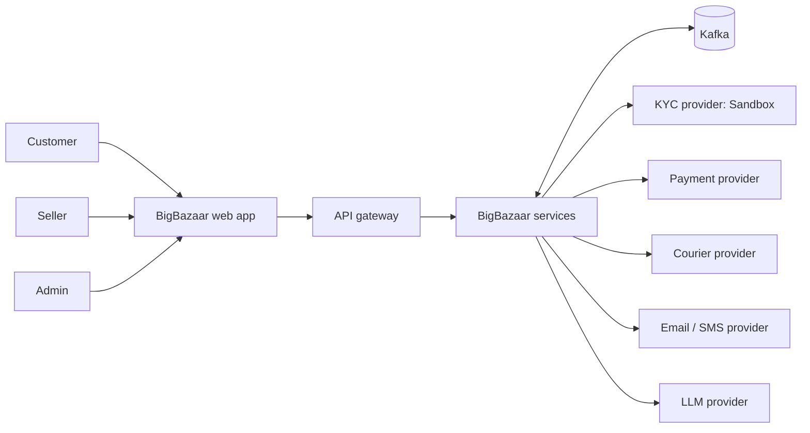
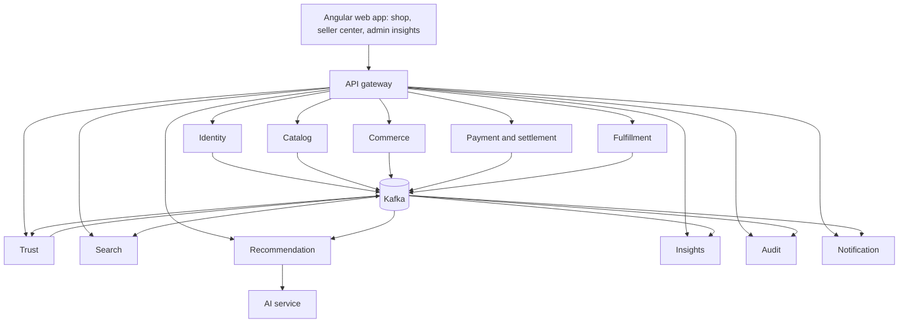
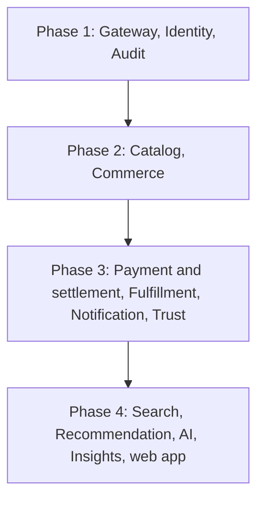
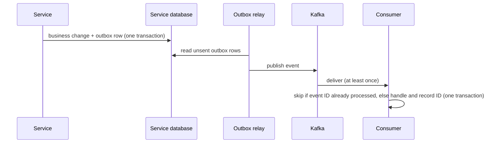
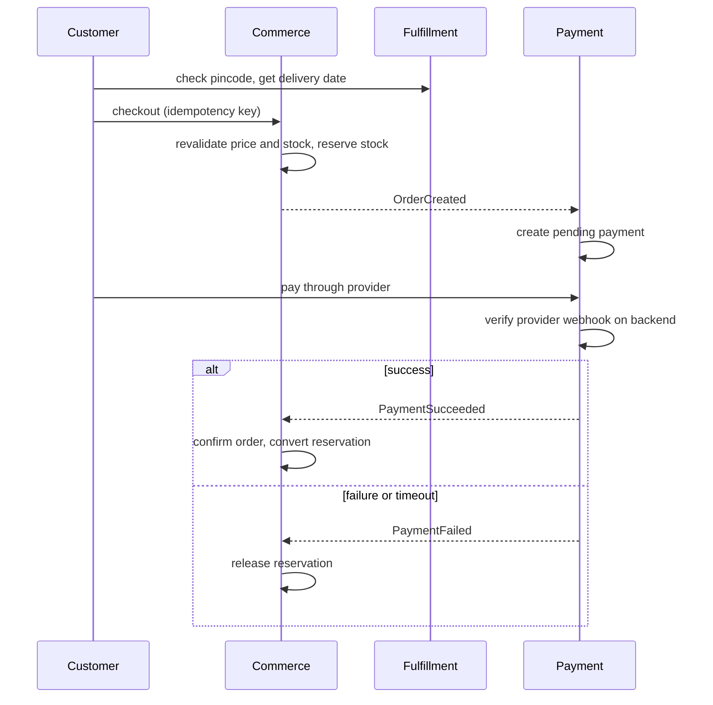
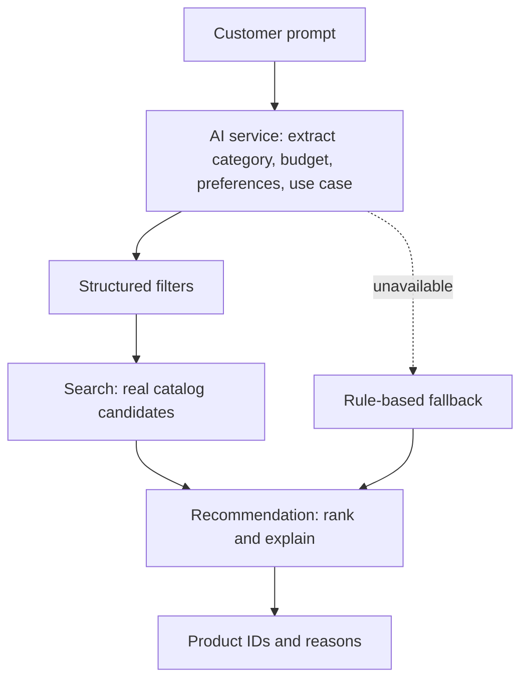
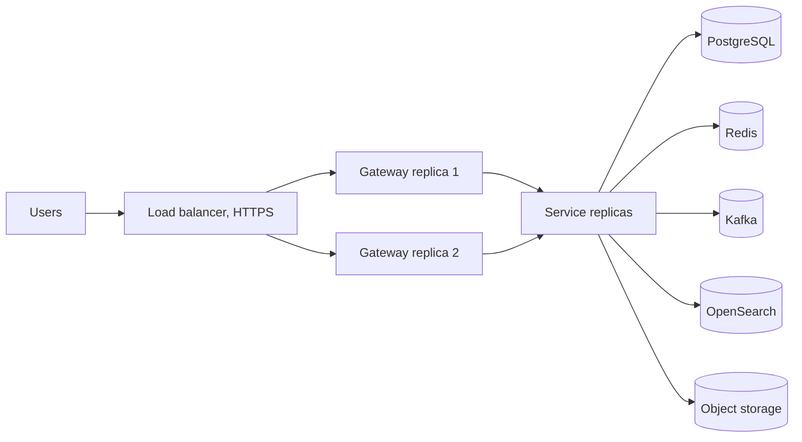

# BigBazaar Software Requirements Specification

**AI-powered, event-driven, multi-vendor e-commerce marketplace**

| | |
|---|---|
| Version | 1.1 |
| Date | 13 October 2026 |
| Replaces | SRS v1.0, 17 July 2026 |
| Prepared for | BigBazaar Java SDE portfolio project |

This SRS defines the BigBazaar project scope, functional and non-functional requirements, system
architecture, data design, event-driven workflows, security model, user interface, deployment model
and acceptance criteria for an interview-ready implementation of about three months.

## Revision history

| Version | Date | Description |
|---|---|---|
| 1.0 | 17 Jul 2026 | Initial complete SRS based on the final BigBazaar architecture plan. |
| 1.1 | 13 Oct 2026 | Automatic seller verification replaces admin approval. Admin becomes an insights and exceptions role; the SUPPORT role is removed. Adds shipping and returns (new Fulfillment service), seller settlement and GST invoicing, automatic listing checks, platform insights and reports (new Insights service), capacity targets and load testing, and a three-area Angular web app. Records Phase 1 work built beyond v1.0 (MFA, RS256 key rotation, audit service, KYC document storage). |

### How to read the changes in v1.1

- Requirement IDs from v1.0 keep their numbers. New requirements get new IDs after the existing ones.
- **[v1.1 new]** marks a new requirement and **[v1.1 changed]** a changed one.
- Decisions behind the changes are recorded as Architecture Decision Records in `docs/adr/`.

## Table of contents

1. Introduction
2. Overall description
3. System architecture
4. User classes and actors
5. Functional requirements
6. Non-functional requirements
7. Microservice requirements
8. Data and database requirements
9. Event-driven architecture
10. Critical workflow requirements
11. AI and recommendation requirements
12. Security requirements
13. User interface requirements
14. External interface requirements
15. Deployment and operations
16. Testing and acceptance criteria
17. Roadmap and scope control
18. Appendices

---

## 1. Introduction

### 1.1 Purpose

This document defines the complete requirements for BigBazaar, an AI-powered e-commerce marketplace
designed for trust, personalization, transparency, reliable order processing and scalable system
design. It guides implementation, testing, deployment and interview presentation.

### 1.2 Project scope

BigBazaar lets customers discover products, receive AI-assisted recommendations, compare products,
manage a cart and wishlist, place orders, pay, track delivery, cancel or return items, submit verified
reviews and raise support tickets.

Sellers apply and are **verified automatically** against government and bank records. Verified sellers
manage products, inventory and orders, meet dispatch deadlines, receive settlements with GST invoices,
and monitor their performance in a seller dashboard.

Admins oversee the platform through read-only insights and reports, and handle the exceptions that
automation cannot decide: unresolved seller verifications, flagged listings, suspensions, disputes,
flagged reviews and support tickets. Every admin action requires MFA, a reason and an audit record.

### 1.3 Final architecture decision

> BigBazaar is implemented as incrementally delivered coarse-grained microservices. Services
> communicate through REST for immediate commands and queries, and Kafka for asynchronous facts and
> workflows. Each service owns its database. The system is Dockerized and designed for load-balanced
> deployment. (ADR 0001)

### 1.4 Definitions and abbreviations

| Term | Meaning |
|---|---|
| SRS | Software Requirements Specification |
| JWT | JSON Web Token used for stateless authentication |
| JWKS | JSON Web Key Set: the public keys other services use to verify tokens |
| MFA | Multi-factor authentication (here, authenticator-app codes) |
| KYC | Know your customer: identity and business checks before someone may sell |
| GSTIN | Goods and Services Tax Identification Number |
| HSN | Harmonised System of Nomenclature code that sets a product's GST rate |
| CGST, SGST, IGST | Central, state and integrated GST |
| TCS | Tax collected at source by the marketplace under GST (section 52, CGST Act) |
| TDS (194-O) | Income tax deducted at source by the marketplace under section 194-O |
| AWB | Air waybill: the courier's tracking number for one parcel |
| NDR | Non-delivery report: the courier could not deliver |
| RTO | Return to origin: an undelivered parcel goes back to the seller |
| Saga | Distributed workflow coordinated through events and compensating actions |
| Outbox | Pattern that saves events in the same transaction as business data |
| Idempotency | Ability to safely retry the same command or event without duplicate side effects |
| Projection | Local read model built from events owned by another service |
| Ledger | Double-entry record of every money movement |
| Settlement | Paying a seller what they are owed for delivered, unreturned orders |
| Soft delete | Marking records as deleted without physically removing them |
| SKU | Stock keeping unit, usually mapped to a product variant |
| DLQ / DLT | Dead-letter queue or topic for messages that cannot be processed |
| RPO / RTO (recovery) | Maximum data loss and maximum downtime after a failure |

---

## 2. Overall description

### 2.1 Product perspective

BigBazaar is not a simple admin-customer web application. It is a system-driven marketplace where
important actions trigger events. The system automatically verifies sellers, checks listings, reserves
stock, confirms payments, books shipments, processes returns, settles sellers, sends notifications,
indexes search, records recommendation signals and audit entries, and recalculates trust scores.
Humans supervise exceptions and high-risk decisions.



*Figure 1. System context.*

### 2.2 Product vision

> To build a scalable and intelligent e-commerce platform where users shop through natural-language
> prompts and receive trustworthy, personalized, explainable recommendations based on real product
> data.

### 2.3 Product differentiators

| Capability | BigBazaar behaviour |
|---|---|
| Trust you can check | Shows product and seller trust scores with the reasons behind them, verified review signals, return rates and risk indicators. |
| AI shopping assistant | Converts natural-language prompts into structured filters and explains each recommendation. Recommends only real catalog products. |
| Price transparency | Shows price history and discount insight, and alerts customers when a wishlist price drops. |
| Inventory reliability | Uses stock reservations and optimistic locking to prevent overselling. |
| Automatic verification | Verifies sellers against GST, PAN, bank and DigiLocker records, and checks listings automatically. People handle only exceptions. |
| Event-driven automation | Uses Kafka events for payments, shipping, returns, settlement, notifications, search, insights, trust and audit. |
| Auditability | Records important actions with actor, entity, reason, old and new values, and correlation ID. |

### 2.4 Constraints

- The initial implementation must be achievable in about three months.
- The system must represent a realistic Java SDE-level microservices design.
- No service may query another service's database.
- AI must recommend real catalog products and must not invent product names.
- Payment success must be verified by backend logic, not trusted from the frontend.
- Deployment must be possible with Docker and environment-based configuration.
- Tax rates, commission rates and time windows must be configuration, not code.

### 2.5 Assumptions

- The first release uses sandbox or mock providers for payments, KYC, couriers and SMS.
- Object storage is S3-compatible, with a local adapter in development (ADR 0005).
- Email uses a sandbox provider in development.
- OpenSearch and Kafka run locally through Docker Compose during development.
- Advanced ML training remains a future extension.
- There is no real traffic. Load is generated with seeded data and load-test scripts (section 6.7).

---

## 3. System architecture

### 3.1 Target architecture



*Figure 2. Target microservice architecture.*

### 3.2 Service build sequence



*Figure 3. Incremental service dependency flow.*

### 3.3 Architecture style

The system uses coarse-grained microservices to balance architectural correctness with implementation
speed. Identity, Catalog, Commerce, Payment, Fulfillment, Notification, Trust, Search,
Recommendation, Insights, Audit and AI are separated by business responsibility. Closely coupled
transactional logic stays together: inventory and order creation remain in Commerce, and the
settlement ledger and invoices remain in Payment, to avoid premature distributed transactions.

### 3.4 Communication rules

| Communication type | Used for | Examples |
|---|---|---|
| REST | Immediate request-response commands and queries | Login, product listing, cart operations, checkout, serviceability check |
| Kafka events | Business facts and asynchronous reactions | OrderCreated, PaymentSucceeded, OrderDelivered, ReturnReceived, PayoutCompleted |
| Provider webhooks | Facts reported by outside providers | Payment status, courier tracking updates |
| Redis | Temporary shared state and cache | Rate limits, product cache, recommendation cache, hot-item stock counters |
| OpenSearch | Search projection | Keyword search, filters, autocomplete |
| Object storage | Files and images | Product images, seller KYC documents, invoices, reports |

### 3.5 Data ownership

> A service owns its database. Other services may store logical IDs or projections, but must not use
> cross-service foreign keys or direct cross-service table queries. Dashboards read only from the
> Insights service, which builds its totals from events.

---

## 4. User classes and actors

### 4.1 Human roles

| Role | Capabilities | Restrictions |
|---|---|---|
| CUSTOMER | Register, verify phone, log in, browse, search, compare, wishlist, cart, checkout, pay, track orders, cancel and return, review delivered products, raise support tickets, use the AI assistant. | Cannot manage products, sellers or platform policy, or see another user's data. |
| SELLER | Apply to sell and complete automatic verification, manage owned products, images, pricing and inventory, fulfil seller orders within deadlines, view settlements and invoices, view their own dashboard. | Cannot change another seller's products or see customer data beyond what fulfilment needs. |
| ADMIN | View all insights, audit logs, customer and seller performance, system health and platform analytics; generate reports. Decide exceptions: unresolved seller verifications, flagged listings, suspensions, disputes, flagged reviews and support tickets. Manage categories and brands. **[v1.1 changed]** | Cannot edit insights, reports, audit entries, status history or payment truth. Does not approve ordinary sellers or listings, or control ordinary order flow. Every action needs MFA, a reason and an audit record. |

The SUPPORT role from v1.0 is removed; its duties move to ADMIN. **[v1.1 changed]**

### 4.2 System actors

| Actor | Purpose |
|---|---|
| SYSTEM | Scheduled jobs, event listeners, automatic seller verification and listing checks, stock release, dispatch-deadline cancellation, settlement cycles, notification triggers, deterministic business rules. |
| AI_SERVICE | Prompt interpretation, recommendation explanations, review summaries, product comparison suggestions, listing-check assistance. |
| External providers | KYC (Sandbox), payment, courier, email and SMS providers, reached only through adapters. |

### 4.3 Role model requirements

- Users may hold multiple roles through `user_roles`.
- Admin-only actions require method-level authorization and an MFA-verified login.
- Seller APIs must verify ownership and verified seller status.
- Suspended users must be blocked from high-risk actions.
- All sensitive role changes must create audit events.

---

## 5. Functional requirements

Priority: **Must** is required for the release; **Should** is planned but may move to the future list
if time runs short.

### 5.1 Authentication and identity

| ID | Requirement | Priority |
|---|---|---|
| FR-AUTH-01 | The system shall allow customers to register with name, email, phone number and password. | Must |
| FR-AUTH-02 | The system shall hash all passwords using an adaptive hashing algorithm before storage. | Must |
| FR-AUTH-03 | The system shall allow login using email and password and return a JWT access token. | Must |
| FR-AUTH-04 | The system shall support refresh-token rotation and logout/revocation. | Must |
| FR-AUTH-05 | The system shall support multi-role users through user_roles. | Must |
| FR-AUTH-06 | The system shall block suspended or locked users from protected operations. | Must |
| FR-AUTH-07 | The system shall rate-limit login and password-sensitive operations. | Should |
| FR-AUTH-08 | The system shall publish UserRegistered and related identity events. | Must |
| FR-AUTH-09 | The system shall verify a customer's phone number with a one-time code before their first order, and publish PhoneVerified. **[v1.1 new]** | Must |
| FR-AUTH-10 | Admin accounts shall use authenticator-app MFA; admin operations shall require a login that passed MFA. **[v1.1 new, built in Phase 1, ADR 0004]** | Must |
| FR-AUTH-11 | Access tokens shall be signed with RS256 and verifiable through a public JWKS endpoint; signing keys shall be rotatable without logging users out. **[v1.1 new, built in Phase 1, ADR 0003]** | Must |

### 5.2 Sellers

| ID | Requirement | Priority |
|---|---|---|
| FR-SELLER-01 | A customer shall be able to submit a seller application. | Must |
| FR-SELLER-02 | The system shall verify seller applications automatically by checking the GSTIN, PAN, bank account (penny drop) and DigiLocker identity through a KYC provider. Applications that pass every check shall be approved automatically. Applications the checks cannot resolve shall go to an admin, who approves or rejects with a reason. Admin may suspend a seller with a reason. **[v1.1 changed, ADR 0007]** | Must |
| FR-SELLER-03 | The system shall record seller status history as immutable data. | Must |
| FR-SELLER-04 | Only verified sellers shall be able to publish products. | Must |
| FR-SELLER-05 | The seller shall be able to view owned product, inventory and seller-order data. | Must |
| FR-SELLER-06 | The system shall publish seller lifecycle events. | Must |
| FR-SELLER-07 | A seller shall see which verification check failed and why, and be able to correct their details and retry. After three failed attempts the application goes to an admin. **[v1.1 new]** | Must |
| FR-SELLER-08 | A seller shall confirm and pack each seller order within a configured dispatch deadline; if they do not, the system shall cancel that seller order and refund the customer automatically. **[v1.1 new]** | Must |
| FR-SELLER-09 | The system shall calculate each seller's cancellation, late-dispatch and return rates. A seller crossing a configured threshold shall be flagged for admin review and notified. **[v1.1 new]** | Should |
| FR-SELLER-10 | Sellers shall be able to upload KYC documents to object storage, checked by file type and size. **[v1.1 new, built in Phase 1, ADR 0005]** | Must |

### 5.3 Catalog

| ID | Requirement | Priority |
|---|---|---|
| FR-CAT-01 | The system shall support categories with parent-child hierarchy. | Must |
| FR-CAT-02 | The system shall support brands. | Must |
| FR-CAT-03 | A verified seller shall be able to create products with variants. | Must |
| FR-CAT-04 | Each product variant shall have a unique active SKU. | Must |
| FR-CAT-05 | The system shall support product image metadata and object storage references. | Must |
| FR-CAT-06 | The system shall support a product status lifecycle from draft through automatic checks to active, rejected, suspended or deleted. | Must |
| FR-CAT-07 | The system shall store price history when variant prices change. | Must |
| FR-CAT-08 | The system shall publish product and price events. | Must |
| FR-CAT-09 | The system shall support paginated and filtered product listing. | Must |
| FR-CAT-10 | Before a listing goes live, the system shall check it automatically: banned items and words, required details, image size and quality, category fit and brand rules. Clear passes go live, clear failures are rejected with a reason the seller can fix, and doubtful listings go to an admin. **[v1.1 new]** | Must |
| FR-CAT-11 | Each product shall carry an HSN code and GST rate. **[v1.1 new]** | Must |
| FR-CAT-12 | Product pages shall show the details Indian e-commerce rules require: seller name, address and GSTIN, return policy, country of origin, and MRP and net quantity for packaged goods. **[v1.1 new]** | Must |

### 5.4 Inventory, cart and wishlist

| ID | Requirement | Priority |
|---|---|---|
| FR-INV-01 | The seller shall be able to add or adjust stock for owned variants. | Must |
| FR-INV-02 | The system shall maintain on-hand and reserved stock separately. | Must |
| FR-INV-03 | The system shall record stock movements as append-only history. | Must |
| FR-INV-04 | The system shall reserve stock during checkout with expiration. | Must |
| FR-INV-05 | The system shall prevent overselling under concurrent checkout requests. | Must |
| FR-INV-06 | The system shall warn sellers when a variant's available stock falls below a threshold they set. **[v1.1 new]** | Should |
| FR-CART-01 | Customers shall be able to add, update, remove and view cart items. | Must |
| FR-CART-02 | Checkout shall revalidate stock and current price, not trust cart snapshots. | Must |
| FR-WISH-01 | Customers shall be able to manage wishlist items. | Should |
| FR-WISH-02 | The system shall notify customers when the price of a wishlist item drops. **[v1.1 new]** | Should |
| FR-CMP-01 | Customers shall be able to compare up to four products side by side, with an AI suggestion that states its reasons. **[v1.1 new]** | Should |

### 5.5 Orders

| ID | Requirement | Priority |
|---|---|---|
| FR-ORD-01 | The system shall create an order from a validated cart. | Must |
| FR-ORD-02 | The system shall split a customer order into seller_orders for multi-vendor fulfilment. | Must |
| FR-ORD-03 | Order items shall store immutable product, SKU, price, tax and address snapshots. | Must |
| FR-ORD-04 | The system shall maintain order status history. | Must |
| FR-ORD-05 | The system shall support idempotent checkout commands. | Must |
| FR-ORD-06 | The system shall publish OrderCreated and later order lifecycle events. | Must |
| FR-ORD-07 | Customers shall view their own orders; sellers shall view only their seller_orders. | Must |

### 5.6 Shipping and delivery **[v1.1 new]**

| ID | Requirement | Priority |
|---|---|---|
| FR-SHIP-01 | Before payment, the system shall check that the delivery pincode is serviceable and show an estimated delivery date. | Must |
| FR-SHIP-02 | When a seller marks a seller order packed, the system shall book a shipment with a courier through an adapter and store the AWB and shipping label. A mock courier is used in development and a courier sandbox for integration. | Must |
| FR-SHIP-03 | The system shall accept signed, deduplicated courier tracking webhooks and update shipment status (picked up, in transit, out for delivery, delivered). | Must |
| FR-SHIP-04 | On a failed delivery (NDR) the customer shall be asked to choose a new attempt; after the configured number of failures the parcel shall return to the seller (RTO) and the order shall be cancelled and refunded. | Should |
| FR-SHIP-05 | Fulfillment shall publish OrderShipped, DeliveryFailed and OrderDelivered. OrderDelivered starts the return window and review eligibility. | Must |

### 5.7 Cancellations, returns and refunds **[v1.1 new]**

| ID | Requirement | Priority |
|---|---|---|
| FR-RET-01 | A customer shall be able to cancel a seller order instantly until it is shipped; stock is released and payment refunded. | Must |
| FR-RET-02 | Each category shall have a configured return window in days, or be marked non-returnable. | Must |
| FR-RET-03 | Within the window, a customer shall be able to request a return for an order item with a reason and optional photos. | Must |
| FR-RET-04 | The system shall book a reverse pickup with the courier and track it. | Must |
| FR-RET-05 | When the returned item is received, the system shall publish ReturnReceived, restock it if resellable, and trigger the refund. | Must |

### 5.8 Payments

| ID | Requirement | Priority |
|---|---|---|
| FR-PAY-01 | The system shall create a pending payment after an order is created. | Must |
| FR-PAY-02 | The system shall verify payment success on the backend. | Must |
| FR-PAY-03 | The system shall store payment attempts and webhook events. | Must |
| FR-PAY-04 | Duplicate provider webhooks shall be ignored safely. | Must |
| FR-PAY-05 | Payment success shall confirm the order and inventory; payment failure shall release inventory. | Must |
| FR-PAY-06 | The system shall support a payment reconciliation job. | Should |
| FR-PAY-07 | The system shall refund cancelled and returned items to the original payment method, in full or in part, and record each refund. **[v1.1 changed: was a simplified Should]** | Must |
| FR-PAY-08 | The system shall never store card numbers. Saved cards shall be tokens held by the payment provider. **[v1.1 new]** | Must |

### 5.9 Settlement and tax **[v1.1 new]**

| ID | Requirement | Priority |
|---|---|---|
| FR-SETL-01 | The system shall record every money movement (payment, commission, fee, tax withheld, refund, payout) in a double-entry ledger whose entries always balance. | Must |
| FR-SETL-02 | The system shall calculate the platform commission per category and any fixed fees, using configured rates. | Must |
| FR-SETL-03 | Money for a seller order shall be held until its return window closes. | Must |
| FR-SETL-04 | The system shall pay sellers on a configured settlement cycle through a payout adapter (mock in development), and publish PayoutCompleted. | Must |
| FR-SETL-05 | Each seller shall be able to view a settlement statement listing orders, commission, fees, tax withheld, refunds and payouts. | Must |
| FR-TAX-01 | The system shall generate a GST invoice in the seller's name for each seller order, stored as a PDF in object storage, and publish InvoiceGenerated. | Must |
| FR-TAX-02 | The invoice shall apply CGST and SGST when seller and buyer are in the same state, or IGST when they are not, using each item's HSN rate. | Must |
| FR-TAX-03 | The system shall withhold TCS under GST and TDS under section 194-O from seller settlements, with rates held in configuration. | Should |

### 5.10 Reviews and trust

| ID | Requirement | Priority |
|---|---|---|
| FR-REV-01 | Only verified buyers with delivered order items shall be able to review products. | Must |
| FR-REV-02 | The system shall allow one active review per user per delivered order item. | Must |
| FR-REV-03 | The system shall support review moderation states and review flags. | Should |
| FR-REV-04 | The system shall flag suspicious reviews by rule: bursts of reviews, reviewers linked to the seller, and near-identical text. Flagged reviews go to admin. **[v1.1 new]** | Must |
| FR-TRUST-01 | The system shall calculate product trust score. | Must |
| FR-TRUST-02 | The system shall calculate seller trust score, including delivery and return performance. | Must |
| FR-TRUST-03 | The system shall store trust-score history with reason components. | Must |
| FR-TRUST-04 | The system shall publish trust-score update events. | Must |

### 5.11 Search, recommendation and AI

| ID | Requirement | Priority |
|---|---|---|
| FR-SRCH-01 | The system shall index active products into OpenSearch through events. | Must |
| FR-SRCH-02 | The system shall support keyword search, filters, sorting and pagination. | Must |
| FR-SRCH-03 | The system shall support autocomplete suggestions. | Should |
| FR-REC-01 | The system shall capture product view, search, cart, wishlist, purchase and review activity. | Must |
| FR-REC-02 | The system shall recommend products using rule-based and content-based ranking. | Must |
| FR-REC-03 | The system shall store recommendation reasons and algorithm version. | Must |
| FR-AI-01 | The AI assistant shall convert prompts into structured product filters. | Must |
| FR-AI-02 | The AI assistant shall recommend only real catalog candidates. | Must |
| FR-AI-03 | The AI assistant shall explain why products were recommended. | Must |
| FR-AI-04 | A fixed set of test prompts with expected results shall run on every AI change. Each AI call shall have a time and cost limit, and be logged. **[v1.1 new]** | Must |

### 5.12 Notification, support and audit

| ID | Requirement | Priority |
|---|---|---|
| FR-NOT-01 | The notification service shall consume domain events and create notification records. | Must |
| FR-NOT-02 | The system shall support email and in-app notifications, and SMS for one-time codes. | Must |
| FR-NOT-03 | Notification failure shall not fail order or payment workflows. | Must |
| FR-SUP-01 | Customers shall be able to raise support tickets, answered by admin. **[v1.1 changed]** | Should |
| FR-AUD-01 | The system shall record important actions as audit events. | Must |
| FR-AUD-02 | Audit events shall contain actor, action, entity, reason, correlation ID, timestamp and changed values where safe. | Must |
| FR-AUD-03 | Audit entries shall be append-only; the database shall refuse updates and deletes. **[v1.1 new, built in Phase 1, ADR 0006]** | Must |

### 5.13 Insights and reports **[v1.1 new]**

| ID | Requirement | Priority |
|---|---|---|
| FR-INS-01 | The seller dashboard shall show the seller's orders, revenue and return rate for a chosen period, with change against the previous period. | Must |
| FR-INS-02 | The seller dashboard shall show the seller's trust score with its reasons, a sales trend, top products and an AI summary of what reviewers praise and complain about. | Must |
| FR-INS-03 | The seller dashboard shall show orders close to their dispatch deadline, low-stock variants and the latest settlement. | Must |
| FR-INS-04 | The admin dashboard shall show platform sales, orders, conversion, cancellations and returns over time. | Must |
| FR-INS-05 | The admin dashboard shall show customer and seller performance, including seller rankings and flagged sellers. | Must |
| FR-INS-06 | The admin dashboard shall show fake-review alerts, risk alerts and the exceptions waiting for a decision. | Must |
| FR-INS-07 | The admin dashboard shall show audit search and system health: service status, error rates, latency and Kafka lag. | Must |
| FR-INS-08 | Admin shall be able to generate reports for a chosen period as CSV, and as PDF where time allows. A report is a snapshot of the data and cannot be edited. | Must (CSV), Should (PDF) |
| FR-INS-09 | Insights and reports shall be read-only for every role. | Must |

---

## 6. Non-functional requirements

### 6.1 Performance

| Area | Target |
|---|---|
| Cached product detail | 95% under 300 ms at the capacity target in 6.7 |
| Search query | 95% under 700 ms for common filters |
| Cart update | 95% under 300 ms |
| Order creation before payment | 95% under 2 s, excluding the payment provider |
| AI recommendation | Under 5 s, with fallback if AI is unavailable |
| Notification processing | Asynchronous, eventually processed with retry |
| Dashboard freshness | Insights at most 60 s behind the events |

### 6.2 Scalability

- Each service shall be stateless and horizontally scalable.
- The gateway and services shall support multiple replicas behind a load balancer.
- High-read services such as Catalog, Search, Recommendation and Insights shall scale independently.
- Kafka consumers shall use consumer groups for scalable event processing.
- Redis and OpenSearch shall be external shared infrastructure, not embedded in application memory.
- During sale-like spikes, stock for hot items may be counted in Redis first, with PostgreSQL as the
  source of truth.

### 6.3 Availability

- Product browsing shall remain available if the AI service is unavailable.
- Payment and order truth shall remain consistent if notification fails.
- A courier, KYC or payment provider outage shall not lose data; work is retried or queued.
- OpenSearch failure shall not corrupt catalog data; indexing shall retry or be reconciled.
- Each service shall expose health and readiness endpoints.

### 6.4 Reliability and resilience

- Critical commands shall be idempotent.
- Kafka consumers shall be idempotent.
- Payment and courier webhooks shall be signature-checked and deduplicated.
- Outbox events shall use retry and dead-letter handling.
- Scheduled jobs shall be idempotent or protected by distributed locks.
- Reconciliation jobs shall detect and repair stuck payment, order, shipment and settlement states.
- Every call to another service or outside provider shall have a timeout and a circuit breaker with
  a defined fallback. **[v1.1 new]**
- Each database shall have a stated recovery point and recovery time, with one restore drill before
  release. **[v1.1 new]**

### 6.5 Maintainability

- Each service shall have a clear package structure, README, OpenAPI documentation and Flyway
  migrations.
- Controllers shall not contain business logic.
- Entities shall not be exposed as API responses.
- Common code sharing shall be minimal and shall not include shared JPA entities.
- Architecture Decision Records shall document major trade-offs.

### 6.6 Observability

- All logs shall include service name and correlation ID.
- Kafka events shall include event ID, event type, version, source service and correlation ID.
- Requests shall be traced across services with OpenTelemetry. **[v1.1 new]**
- Metrics shall include latency, error rate, request count, cache hit ratio, Kafka lag, payment
  failures, inventory reservation conflicts, delivery failures and settlement failures.
- The system shall support health checks, structured logs and dashboard-ready metrics.

### 6.7 Capacity targets and load testing **[v1.1 new]**

BigBazaar has no real traffic, so load is generated.

- A seed script shall create realistic test data: at least 500 sellers, 20,000 products and 5,000
  customers.
- Load-test scripts (k6) shall simulate browsing, searching, cart and checkout.
- Initial targets on the stated test hardware: 200 browse requests per second and 50 checkouts per
  second, at the latencies in 6.1. The final numbers shall be set from the first load-test run and
  recorded with the hardware used.
- The services shall read time from an injectable clock so tests can move through return windows and
  settlement cycles.
- A load-test report shall be part of the release evidence.

---

## 7. Microservice requirements

| Service | Stack | Data owner | Responsibilities | Main events |
|---|---|---|---|---|
| Identity | Java Spring Boot | identity_db | Auth, users, roles, MFA, signing keys, phone verification, sellers, automatic seller verification, KYC documents | UserRegistered, PhoneVerified, SellerApproved, SellerRejected, SellerSuspended |
| API gateway | Spring Cloud Gateway | none (Redis for rate limits) | Routing, CORS, rate limiting, correlation IDs, token check | none |
| Audit **[v1.1 new row]** | Java Spring Boot | platform_db | Append-only audit log of all events, admin audit search | consumes all |
| Catalog | Java Spring Boot | catalog_db | Categories, brands, products, variants, images, price history, HSN and legal fields, automatic listing checks | ProductPublished, ListingRejected, ProductPriceChanged |
| Commerce | Java Spring Boot | commerce_db | Inventory, reservations, cart, wishlist, orders, seller_orders, dispatch deadlines, cancellations | OrderCreated, StockReserved, OrderCancelled |
| Payment and settlement **[v1.1 changed]** | Java Spring Boot | payment_db | Payment attempts, verification, webhooks, refunds; ledger, commission, settlements, payouts, GST invoices, TCS/TDS | PaymentSucceeded, PaymentFailed, RefundCompleted, InvoiceGenerated, PayoutCompleted |
| Fulfillment **[v1.1 new]** | Java Spring Boot | fulfillment_db | Serviceability, shipments, courier adapter, tracking webhooks, NDR/RTO, returns and reverse pickup | OrderShipped, DeliveryFailed, OrderDelivered, ReturnRequested, ReturnReceived |
| Notification | Java Spring Boot | notification_db | Email, SMS, in-app messages, retries, delivery history | consumes events |
| Trust | Java Spring Boot | trust_db | Verified reviews, flags, fake-review rules, trust scores, score history | ReviewPublished, ReviewFlagged, TrustScoreUpdated |
| Search | Java Spring Boot + OpenSearch | OpenSearch | Indexing, search, filters, autocomplete | consumes product, stock and trust events |
| Recommendation | Java, or Python/Java mix | recommendation_db | User activity, ranking, reasons, logs | RecommendationGenerated |
| Insights **[v1.1 new]** | Java Spring Boot | insights_db | Read-only totals for seller and admin dashboards, reports | consumes all |
| AI service | Python FastAPI | optional ai logs | Intent extraction, comparison, review summary, explanations, listing-check assistance, AI test set | none or AIRequestLogged |

### 7.1 Service completion gate

1. Flyway migrations run on an empty database.
2. Unit and integration tests pass.
3. Security and ownership tests pass where applicable.
4. Kafka producer or consumer tests pass where applicable.
5. Docker image builds and the health endpoint works.
6. OpenAPI and example requests are updated.
7. The service README explains responsibilities and failure handling.

---

## 8. Data and database requirements

### 8.1 Database strategy

PostgreSQL database-per-service ownership. In local development one PostgreSQL server may host several
databases. In production each service has its own credentials and cannot access another service's
database.

### 8.2 Common data conventions

| Concern | Requirement |
|---|---|
| IDs | UUID for public and business entities; BIGINT for high-volume append-only logs where useful. |
| Time | TIMESTAMPTZ in PostgreSQL and Instant in Java, read from an injectable clock. |
| Money | NUMERIC(12,2) in PostgreSQL and BigDecimal in Java. Ledger amounts use the same type. |
| Tax and commission rates | Stored as configuration with an effective-from date, never hard-coded. |
| Enums | Store string values; never use ordinals. |
| Schema | Flyway migrations; Hibernate ddl-auto=validate in deployable environments. |
| Deletes | Selective soft delete, and immutable history where required. |
| Indexes | Based on access patterns; avoid unnecessary write-heavy indexes. |
| Pagination | All large listings must be paginated. |
| Personal data | Encrypt sensitive numbers at rest (bank account, PAN date); show only the last four digits; never store Aadhaar numbers. |

### 8.3 Soft delete requirements

Soft-deletable entities use `deleted_at`, `deleted_by` and `delete_reason`. A record is active when
`deleted_at` is null. Transactional history such as orders, payments, ledger entries, invoices, stock
movements, price history, order status history, shipment events and audit events is not soft-deleted
in normal operation.

### 8.4 Core database modules

| Database | Important tables |
|---|---|
| identity_db | users, roles, user_roles, addresses, phone_verifications, user_mfa, recovery_codes, sellers, seller_documents, seller_verifications, seller_verification_checks, seller_status_history, refresh_tokens, outbox_events |
| catalog_db | verified_seller_projection, categories (with return window and commission rate), brands, products (with HSN, GST rate, legal fields), product_variants, product_images, price_history, listing_checks, outbox_events, processed_events |
| commerce_db | product_projection, inventory, stock_reservations, stock_movements, carts, cart_items, wishlists, orders, seller_orders, order_items, order_status_history, idempotency_keys, outbox_events, processed_events |
| payment_db | payments, payment_attempts, payment_webhook_events, refunds, ledger_accounts, ledger_entries, settlements, settlement_items, payouts, invoices, outbox_events, processed_events |
| fulfillment_db | serviceable_pincodes, shipments, shipment_events, courier_webhook_events, return_requests, reverse_pickups, outbox_events, processed_events |
| notification_db | notifications, delivery_attempts, preferences, processed_events |
| trust_db | delivered_item_projection, reviews, review_flags, review_summaries, product_scores, seller_scores, score_history, outbox_events, processed_events |
| recommendation_db | user_activity, user_preferences, recommendation_logs, recommendation_items, product_similarity, ai_requests, processed_events |
| insights_db | daily_platform_totals, daily_seller_totals, daily_product_totals, alert_feed, report_runs, processed_events |
| platform_db | audit_events, processed_events, support_tickets, ticket_messages |

### 8.5 Important index and constraint requirements

```sql
CREATE UNIQUE INDEX uk_users_email_active
  ON users (LOWER(email))
  WHERE deleted_at IS NULL;

CREATE UNIQUE INDEX uk_product_variants_sku_active
  ON product_variants (sku)
  WHERE deleted_at IS NULL;

ALTER TABLE inventory
  ADD CONSTRAINT chk_inventory_available
  CHECK (on_hand_quantity >= reserved_quantity);

CREATE INDEX idx_orders_user_created
  ON orders (user_id, created_at DESC);

CREATE INDEX idx_reservations_expiry
  ON stock_reservations (status, expires_at)
  WHERE status = 'ACTIVE';

-- v1.1: one shipment per seller order, one webhook per courier event
CREATE UNIQUE INDEX uk_shipments_seller_order ON shipments (seller_order_id);
CREATE UNIQUE INDEX uk_courier_webhook_event ON courier_webhook_events (provider, provider_event_id);

-- v1.1: every ledger transaction balances (enforced on insert of the transaction's entries)
-- SUM(debit) = SUM(credit) per transaction_id
```

### 8.6 Inventory data requirements

> available_quantity = on_hand_quantity − reserved_quantity. A reservation succeeds only when
> available_quantity is at least the requested quantity.

### 8.7 Order data requirements

- Orders store address snapshots.
- Order items store product, SKU, variant, price, HSN and tax-rate snapshots.
- Orders are split into seller_orders for multi-vendor fulfilment.
- Order status changes are stored in append-only order_status_history.
- Checkout uses idempotency keys.

### 8.8 Ledger data requirements **[v1.1 new]**

- Each money movement is one ledger transaction made of two or more entries whose debits equal their
  credits.
- Accounts include: customer payments, platform commission, platform fees, tax withheld (TCS, TDS),
  seller payable per seller, refunds and payouts.
- Ledger entries are append-only. Corrections are new reversing entries, never edits.
- A seller's balance is the sum of their payable account's entries.

---

## 9. Event-driven architecture

### 9.1 Event standards

```java
public record EventEnvelope<T>(
    UUID eventId,
    String eventType,
    int eventVersion,
    String sourceService,
    UUID correlationId,
    Instant occurredAt,
    T payload
) {}
```

### 9.2 Transactional outbox pattern



*Figure 5. Transactional outbox and idempotent consumer (ADR 0002).*

### 9.3 Event catalog

| Topic | Events |
|---|---|
| identity-events | UserRegistered, PhoneVerified, UserSuspended, SellerApplicationSubmitted, SellerVerificationStarted, SellerApproved, SellerRejected, SellerSuspended, SellerDocumentUploaded, SellerFlagged |
| product-events | ProductCreated, ProductUpdated, ProductPublished, ListingRejected, ProductDeactivated, ProductPriceChanged |
| commerce-events | StockReserved, StockReleased, StockLow, OrderCreated, OrderConfirmed, OrderPacked, OrderCancelled |
| payment-events | PaymentInitiated, PaymentSucceeded, PaymentFailed, RefundRequested, RefundCompleted, InvoiceGenerated, SettlementCreated, PayoutCompleted |
| fulfillment-events **[v1.1 new]** | ShipmentBooked, OrderShipped, DeliveryFailed, OrderDelivered, ReturnRequested, ReturnPickedUp, ReturnReceived, ReturnedToOrigin |
| trust-events | ReviewSubmitted, ReviewPublished, ReviewFlagged, ProductTrustScoreUpdated, SellerTrustScoreUpdated |
| recommendation-events | ProductViewed, ProductWishlisted, ProductAddedToCart, ProductPurchased, RecommendationClicked |
| notification-events | NotificationCreated, NotificationSent, NotificationFailed |

### 9.4 Consumer requirements

- Every consumer records processed event IDs with the consumer name.
- Consumers ignore duplicate events safely.
- Consumers use retry and dead-letter handling for failures.
- Consumers log event ID, correlation ID and failure reason.
- Event schemas are versioned and backward-compatible when possible.

---

## 10. Critical workflow requirements

### 10.1 Checkout and payment saga



*Figure 6. Checkout and payment saga.*

### 10.2 Seller verification flow **[v1.1 changed, ADR 0007]**

```
Seller submits GSTIN, PAN date, bank account, then connects DigiLocker
 -> Identity records the application (PENDING_VERIFICATION) and SellerVerificationStarted
 -> Background job runs four checks through the KYC provider
 -> All pass: seller APPROVED by SYSTEM, SELLER role granted, SellerApproved
 -> A check fails: seller sees the reason, corrects and retries (up to three times)
 -> Still unresolved or provider unavailable after retries: UNDER_REVIEW, admin decides with reason
 -> Catalog builds its verified-seller projection from the events
 -> Audit records each step
```

### 10.3 Product publication flow **[v1.1 changed]**

```
Verified seller creates product (with HSN, GST rate, legal fields)
 -> Catalog checks the seller projection
 -> Catalog runs automatic listing checks
 -> Pass: ProductPublished | Fail: ListingRejected with reason | Unsure: admin decides
 -> Commerce updates product projection
 -> Search indexes product
 -> Audit records action
```

### 10.4 Shipping and delivery flow **[v1.1 new]**

```
Seller marks seller order packed (before the dispatch deadline)
 -> Fulfillment books shipment through the courier adapter, stores AWB and label, ShipmentBooked
 -> Courier webhooks: picked up -> OrderShipped; in transit; out for delivery
 -> Delivered -> OrderDelivered
      -> Commerce marks DELIVERED, Trust opens review eligibility,
         Payment starts the return-window hold, Notification informs customer
 -> Failed attempt -> DeliveryFailed, customer picks a new attempt
 -> Too many failures -> ReturnedToOrigin -> order cancelled and refunded
Missed dispatch deadline -> Commerce cancels seller order -> refund
```

### 10.5 Return and refund flow **[v1.1 new]**

```
Customer requests return within the window, with reason
 -> Fulfillment validates the window and category, ReturnRequested
 -> Reverse pickup booked and tracked, ReturnPickedUp
 -> Item received, ReturnReceived
      -> Commerce restocks if resellable (stock movement appended)
      -> Payment refunds to the original method, RefundCompleted, ledger reversal entries
      -> Trust and Insights update return rates
```

### 10.6 Settlement and payout flow **[v1.1 new]**

```
PaymentSucceeded -> ledger: customer payment, seller payable, commission, fees
InvoiceGenerated for each seller order (CGST+SGST or IGST)
Return window closes for a delivered seller order -> amount becomes payable
Settlement cycle job (idempotent, locked) -> settlement per seller:
   payable - commission - fees - TCS - TDS - refunds
 -> payout through adapter -> PayoutCompleted -> settlement statement for the seller
```

### 10.7 Review and trust flow

```
OrderDelivered
 -> Trust stores delivered item projection
 -> Customer submits review
 -> Trust verifies order item eligibility and runs fake-review rules
 -> ReviewPublished, or ReviewFlagged for admin
 -> Product and seller trust recalculated
 -> Catalog, Search, Recommendation and Insights receive trust updates
```

### 10.8 Payment failure flow

```
PaymentFailed
 -> Commerce marks order payment failed
 -> Commerce releases active reservation
 -> Stock movement is appended
 -> Notification informs customer
 -> Insights records the failure
```

---

## 11. AI and recommendation requirements

### 11.1 AI assistant requirements



*Figure 7. AI prompt-based recommendation flow.*

- The AI service extracts category, budget, preferences and use case from natural-language prompts.
- The AI service returns structured filters, not invented products.
- The Search service provides real catalog candidates.
- The Recommendation service ranks candidates using relevance, trust, price fit, rating, seller score,
  review quality and availability.
- The final response includes product IDs and explanations.
- If AI fails, the system falls back to rule-based recommendations.
- Product comparison (FR-CMP-01) uses the same grounding: the AI may only compare the attributes of
  the chosen real products and must state its reasons.
- Listing checks (FR-CAT-10) may use the AI service for category fit and image relevance; the
  decision rules stay deterministic and logged.

### 11.2 Ranking formula, version 1

```
Final score =
    0.25 × relevance score
  + 0.20 × product trust score
  + 0.15 × rating score
  + 0.15 × price fit score
  + 0.10 × seller score
  + 0.10 × review quality score
  + 0.05 × delivery and stock confidence
```

### 11.3 Recommendation logs

The system stores recommendation logs, recommendation items, ranks, scores, reason codes, algorithm
version, clicks, cart additions and purchases. These logs support explainability and future model
improvement.

### 11.4 AI quality and guardrails **[v1.1 new]**

- A versioned test set of prompts with expected filters and constraints runs on every change to
  prompts or models (FR-AI-04).
- Customer text is treated as data; the AI service never executes instructions found in product
  data or reviews.
- Each call has a timeout and a cost ceiling; requests, latency and outcome are logged.

---

## 12. Security requirements

| Area | Requirement |
|---|---|
| Authentication | RS256 JWT access tokens with JWKS and key rotation, refresh-token rotation, logout/revocation, BCrypt password hashing, phone verification by one-time code. |
| Admin access | Authenticator-app MFA required for every admin operation; checked in each service, not only the gateway. |
| Authorization | Role-based access and ownership checks for seller resources. Insights are read-only for all roles. |
| API protection | Rate limiting, validation, error sanitization, CORS configuration. |
| Payment | Backend verification, signed webhook validation, duplicate event detection. No card numbers stored. |
| Courier and KYC providers | Signed webhook validation, duplicate detection, credentials in secret storage. |
| Secrets | No secrets in source code; environment variables locally and a secret manager in deployment. |
| Audit | Sensitive admin actions require a reason and an audit record. Audit entries cannot be changed. |
| Data protection | Never log tokens, passwords, payment secrets or documents. Encrypt sensitive numbers at rest. Store no Aadhaar numbers. Follow India's DPDP Act for consent and data requests. |
| File uploads | Validate type by content, size and storage path; store files outside PostgreSQL. |

### 12.1 Standard error response

```json
{
  "success": false,
  "code": "INSUFFICIENT_STOCK",
  "message": "Requested quantity is unavailable.",
  "correlationId": "uuid",
  "timestamp": "2026-07-17T10:30:00Z",
  "fieldErrors": []
}
```

---

## 13. User interface requirements **[v1.1 changed]**

BigBazaar has **one Angular web app with three areas**. Each area is lazy-loaded and guarded by role;
the guards only shape the screen, and every permission is enforced by the backend. Components use
Angular Material; charts use ECharts.

### 13.1 Shop (public and customer)

- Home page with the AI search box, suggested prompts, and rows for "Recommended for you", "Best
  trusted deals", "Popular in your budget", "Because you searched…" and "Price dropped from your
  wishlist".
- Product listing with filters, sort, pagination, trust score and price information.
- Product card with price and MRP, rating, trust score, return rate and an "Ask AI" action.
- Product detail page with variants, trust score and reasons, seller score, price history, stock
  state, estimated delivery date, legal seller details, reviews and AI summary.
- Compare page for up to four products with an AI suggestion.
- AI shopping assistant panel with explained recommendations and "add best to cart".
- Login, registration and phone verification.
- Profile and address management; cart and wishlist.
- Checkout with pincode check and payment.
- Order history, tracking, cancellation and returns.
- Verified review submission; support tickets.

### 13.2 Seller center

- Seller application, verification progress and the reason for any failed check, with retry.
- Dashboard: orders, revenue, return rate and trust score with period comparison; sales trend; top
  products; AI review summary.
- Orders queue with dispatch-deadline timers, packing and shipping labels.
- Product management, listing-check results, inventory and low-stock warnings.
- Returns for the seller's orders.
- Settlement statements, payouts and GST invoices.

### 13.3 Admin insights

- Platform overview: sales, orders, conversion, cancellations and returns over time.
- Customer and seller performance, seller rankings and flagged sellers.
- Alerts: fake reviews, risk alerts, flagged listings.
- Exceptions queue: unresolved seller verifications, flagged listings, suspensions, disputes, flagged
  reviews and support tickets. Each decision asks for a reason.
- Audit log search.
- System health: service status, error rates, latency, Kafka lag.
- Reports: choose a period and download CSV (and PDF where available).
- Category and brand management.

---

## 14. External interface requirements

| Interface | Purpose | Development | Integration |
|---|---|---|---|
| KYC provider | GSTIN, PAN, penny drop, DigiLocker | Mock provider | Sandbox (sandbox.co.in) test keys |
| Payment provider | Payments, refunds, card tokens | Mock provider | Provider sandbox |
| Payout provider | Seller payouts | Mock adapter | Provider sandbox |
| Courier provider | Serviceability, shipments, labels, tracking webhooks, reverse pickup | Mock courier | Aggregator sandbox |
| Email and SMS | Notifications and one-time codes | Local mail catcher, logged SMS | Provider sandbox |
| LLM provider | AI service | Recorded responses for tests | Provider API |
| Object storage | Documents, images, invoices, reports | Local adapter | S3-compatible |

Every provider is reached through an adapter interface in the owning service, so a provider can be
swapped with configuration only.

---

## 15. Deployment and operations



*Figure 8. Deployment and load-balancing architecture.*

### 15.1 Environments

| Environment | Purpose |
|---|---|
| Local development | Docker Compose for PostgreSQL, Redis, Kafka, OpenSearch and the services. |
| Integration | All completed services run through the gateway with seeded test data. |
| Portfolio deployment | Cloud container deployment with managed database, Redis, object storage and HTTPS. |
| Future production | Managed Kafka and OpenSearch, independent autoscaling per service. |

### 15.2 Load balancing requirements

- Gateway and service instances are stateless.
- Multiple replicas are supported for the gateway and services.
- The load balancer routes only to healthy replicas.
- Sessions are not stored in JVM memory.
- Shared state lives in PostgreSQL, Redis, Kafka, OpenSearch or object storage.

### 15.3 CI/CD requirements

- Build and test every service independently.
- Run migrations in controlled deployment order.
- Build Docker images.
- Run integration tests before deployment.
- Run the AI test set when AI prompts or models change.
- Use environment-specific configuration.

---

## 16. Testing and acceptance criteria

### 16.1 Test types

| Test type | Coverage |
|---|---|
| Unit tests | Business rules, mappers, score formulas, tax and commission calculation, validators, status transitions. |
| Repository tests | Constraints, soft delete, locking, ledger balance and queries with Testcontainers. |
| Controller tests | API validation, auth, error responses, pagination. |
| Security tests | Role access, seller ownership, suspended-account rejection, admin MFA, read-only insights. |
| Kafka tests | Producer, consumer, idempotency, retry, DLQ behaviour. |
| Concurrency tests | Two users reserving the final unit; two settlement jobs running at once. |
| Time-based tests | Reservation expiry, dispatch deadline, return window, settlement cycle, using the injectable clock. |
| End-to-end tests | Register → automatic seller verification → product → listing checks → cart → order → payment → shipment → delivery → return or review → settlement → trust. |
| Resilience tests | AI, notification, courier and KYC provider unavailable; duplicate payment and courier webhooks; duplicate Kafka events. |
| Load tests | Section 6.7 targets with seeded data. |
| AI tests | The AI test set (FR-AI-04). |

### 16.2 Acceptance criteria

1. Users can register, verify their phone, log in, refresh tokens and access role-appropriate APIs.
2. Sellers with valid records are approved automatically; unresolved cases reach admin, and every
   decision is auditable.
3. Verified sellers can publish products that pass automatic listing checks, with variants and
   inventory.
4. Customers can search, compare, add to cart, check out and place orders.
5. Concurrent checkout cannot oversell inventory.
6. Payment success confirms order and stock; payment failure releases stock.
7. Orders are shipped, tracked and delivered through the courier adapter; missed dispatch deadlines
   cancel and refund automatically.
8. Customers can cancel before shipping and return within the window, and are refunded.
9. Sellers receive settlements with GST invoices, and the ledger balances.
10. Notifications are processed asynchronously.
11. Only delivered order items can be reviewed; suspicious reviews are flagged.
12. Trust scores update and are visible in product discovery.
13. AI recommendations return real product candidates and explain reasons; the AI test set passes.
14. Seller and admin dashboards show correct, read-only insights; admin can download a CSV report.
15. A load test meets the recorded capacity targets.
16. Services run through Docker and the gateway.
17. Core diagrams, API docs, tests and README files are complete.

---

## 17. Roadmap and scope control

### 17.1 Release must-haves

- Identity, authentication, roles, MFA, automatic seller verification.
- Catalog, products, variants, price history, listing checks, tax and legal fields.
- Inventory reservation, cart, orders, seller_orders, dispatch deadlines, cancellations.
- Payment sandbox, backend verification, saga events, refunds.
- Fulfillment with mock courier: shipping, tracking, delivery, returns.
- Settlement ledger, payouts and GST invoices.
- Notifications, verified reviews, fake-review rules, trust scores.
- Search, recommendation, AI assistant.
- Insights service, three-area Angular app.
- Docker deployment, monitoring, tracing, load test, tests and documentation.

### 17.2 Simplify initially

- Use sandbox or mock providers for payments, payouts, KYC, couriers and SMS.
- Use deterministic trust scores and rule-based fake-review checks before ML.
- Use email, SMS for codes and in-app notifications before push and WhatsApp.
- Use rule-based and content-based recommendation before collaborative filtering.
- Use Docker or cloud containers before Kubernetes.
- If time runs short, move these to the future list first: price-drop alerts (FR-WISH-02), product
  comparison (FR-CMP-01), PDF reports (FR-INS-08 PDF part), seller threshold flags (FR-SELLER-09).

### 17.3 Future enhancements

- Predictive insights: demand and sales forecasts for admin and sellers.
- Crypto payments. Crypto is not legal tender in India and regulated payment providers do not settle
  it; transfers also carry 30% tax and 1% TDS. Any support would come through a licensed third-party
  provider or for customers outside India, after a legal review. The payment adapter design keeps this
  a contained change.
- Shared product pages with offers from many sellers.
- Cash on delivery, coupons and promotions.
- Visual search and Indian-language search.
- Real courier integration beyond the sandbox, and live map tracking.
- Advanced fraud and fake-review ML.
- Multi-region deployment, Kubernetes and predictive autoscaling.
- Platform-run warehouses.
- Feature flags and A/B testing of ranking versions.

---

## 18. Appendices

### Appendix A. Status enums

```
UserStatus:          PENDING_VERIFICATION, ACTIVE, LOCKED, SUSPENDED, DEACTIVATED
SellerStatus:        DRAFT, PENDING_VERIFICATION, UNDER_REVIEW, APPROVED, REJECTED, SUSPENDED, CLOSED
ProductStatus:       DRAFT, PENDING_CHECKS, PENDING_APPROVAL, ACTIVE, INACTIVE, OUT_OF_STOCK,
                     REJECTED, SUSPENDED, DELETED
ReservationStatus:   ACTIVE, CONFIRMED, RELEASED, EXPIRED, CANCELLED
OrderStatus:         CREATED, INVENTORY_RESERVED, PAYMENT_PENDING, PAYMENT_SUCCESS, PAYMENT_FAILED,
                     CONFIRMED, PACKED, SHIPPED, DELIVERED, CANCELLED, RETURN_REQUESTED,
                     RETURNED, REFUNDED
SellerOrderStatus:   CONFIRMED, PACKED, SHIPPED, DELIVERED, CANCELLED, RETURNED_TO_ORIGIN
ShipmentStatus:      BOOKED, PICKED_UP, IN_TRANSIT, OUT_FOR_DELIVERY, DELIVERED, DELIVERY_FAILED,
                     RETURNED_TO_ORIGIN
ReturnStatus:        REQUESTED, PICKUP_SCHEDULED, PICKED_UP, RECEIVED, REFUNDED, REJECTED
PaymentStatus:       CREATED, PENDING, AUTHORIZED, CAPTURED, FAILED, CANCELLED,
                     PARTIALLY_REFUNDED, REFUNDED
SettlementStatus:    PENDING, PAYABLE, PAID, FAILED
ReviewStatus:        PUBLISHED, PENDING_MODERATION, FLAGGED, HIDDEN, REMOVED
```

`PENDING_CHECKS` is new in v1.1: the listing is running automatic checks. `PENDING_APPROVAL` now means
the checks were unsure and an admin decides.

### Appendix B. Interview focus points

- Why BigBazaar uses coarse-grained microservices instead of twenty services at once.
- How inventory reservation prevents overselling.
- Why outbox and idempotency are necessary with Kafka.
- How the payment saga handles success, failure and retries.
- How automatic seller verification replaces manual approval, and where people still decide.
- How a double-entry ledger keeps seller settlements correct.
- How shipping, returns and the return window drive when sellers are paid.
- Why OpenSearch and Insights are projections and PostgreSQL remains the source of truth.
- How soft delete differs from immutable transactional history.
- How AI recommendations are grounded in real catalog data and tested.
- How load testing works without real traffic.
- How load balancing works with stateless services.

### Appendix C. Implementation timeline

| Phase | Weeks | Outcome |
|---|---|---|
| 1. Platform, identity, gateway | 1–2 | Authentication, roles, MFA, automatic seller verification, audit, gateway routing. Done; phone verification and seller retry added. |
| 2. Catalog and commerce | 3–5 | Products with tax and legal fields, listing checks, inventory, cart, orders, seller orders, dispatch deadlines, cancellations. |
| 3. Payment, fulfillment, notification, trust | 6–8 | Payment saga, refunds, Fulfillment service, returns, settlement ledger, payouts, GST invoices, notifications, reviews, fake-review rules, trust scores. |
| 4. Search, AI, insights, deployment | 9–12 | OpenSearch, recommendations, AI assistant and test set, comparison, Insights service, Angular app, tracing, load tests, deployment. |

Phase 3 carries the most new work. Whether to extend past twelve weeks is decided as the project
progresses.

### Appendix D. Changes from v1.0

| Area | v1.0 | v1.1 |
|---|---|---|
| Seller approval | Admin approves every seller | Automatic KYC; admin decides only unresolved cases (FR-SELLER-02, -07) |
| Product approval | Undefined `PENDING_APPROVAL` | Automatic listing checks (FR-CAT-10) |
| Roles | CUSTOMER, SELLER, SUPPORT, ADMIN | SUPPORT removed; ADMIN is insights plus exceptions |
| Delivery | Statuses only; courier is future | Fulfillment service (FR-SHIP-01–05) |
| Returns | Simplified refund (Should) | Cancellations, returns, refunds (FR-RET-01–05, FR-PAY-07 Must) |
| Seller money | Payout automation is future | Ledger, settlement, payouts (FR-SETL-01–05) |
| Tax | None | HSN, GST invoices, TCS/TDS (FR-CAT-11, FR-TAX-01–03) |
| Dashboards | Bullet lists | Insights service and three dashboards (FR-INS-01–09) |
| Capacity | Development-load latency only | Targets, seed data, k6 load tests (6.7) |
| Built in Phase 1 | Not in v1.0 | MFA, RS256 rotation, audit service, KYC documents recorded (FR-AUTH-10–11, FR-SELLER-10, FR-AUD-03) |
| UI | Unspecified framework | One Angular app with three areas |
